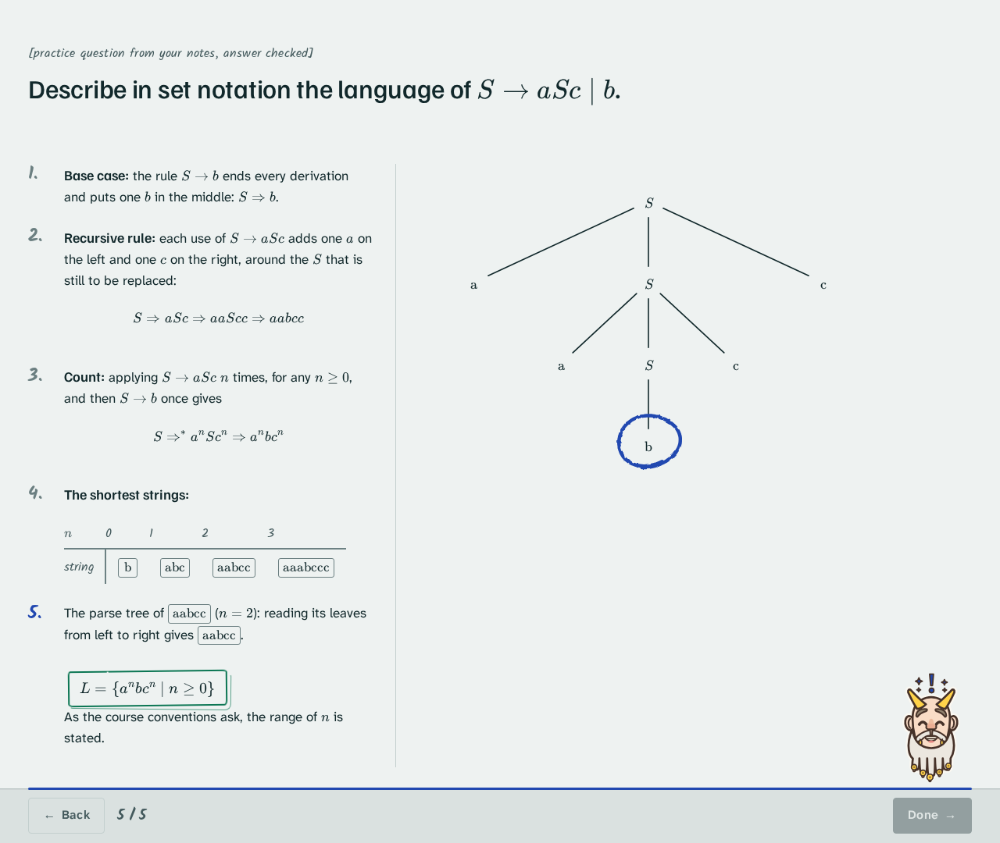
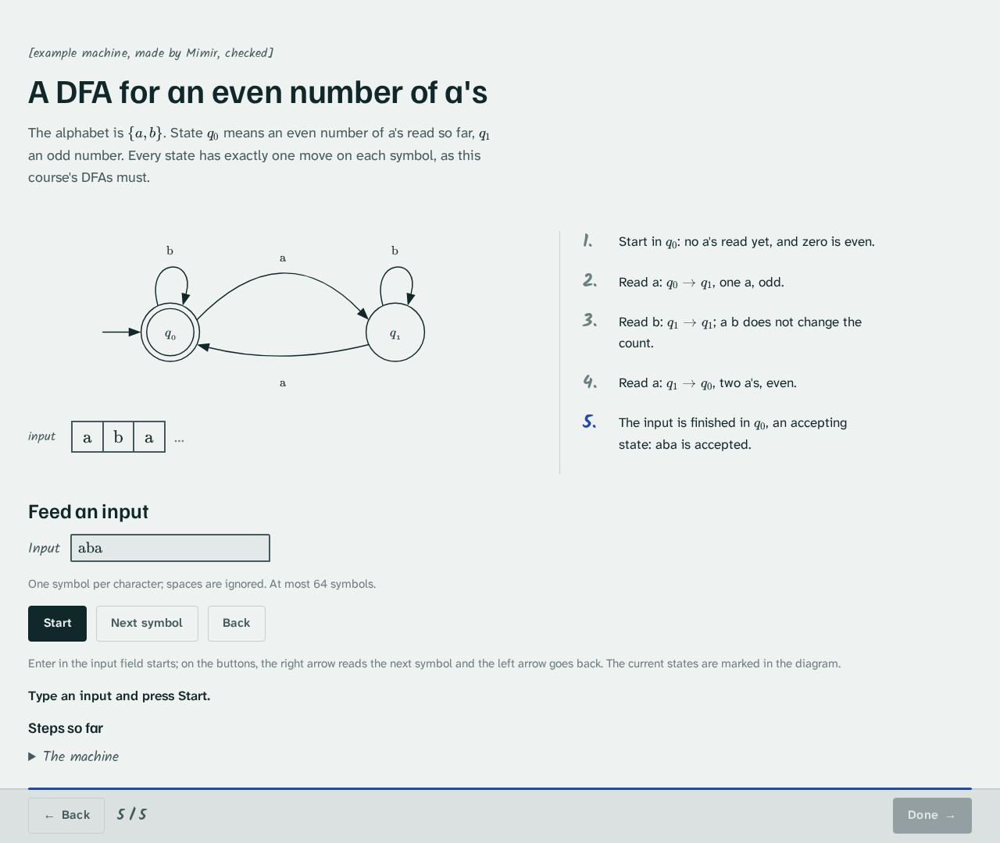
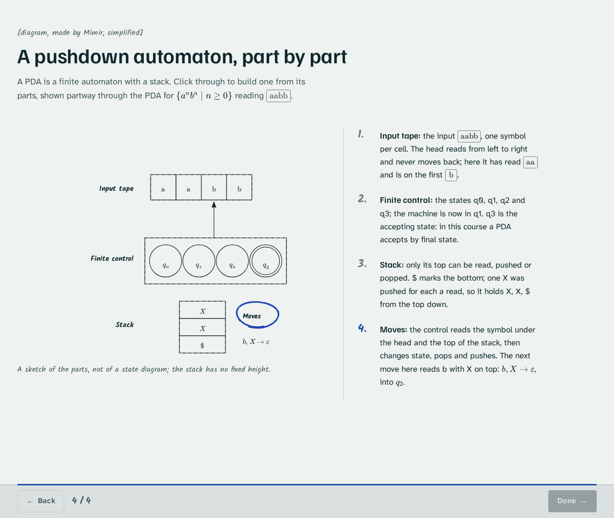
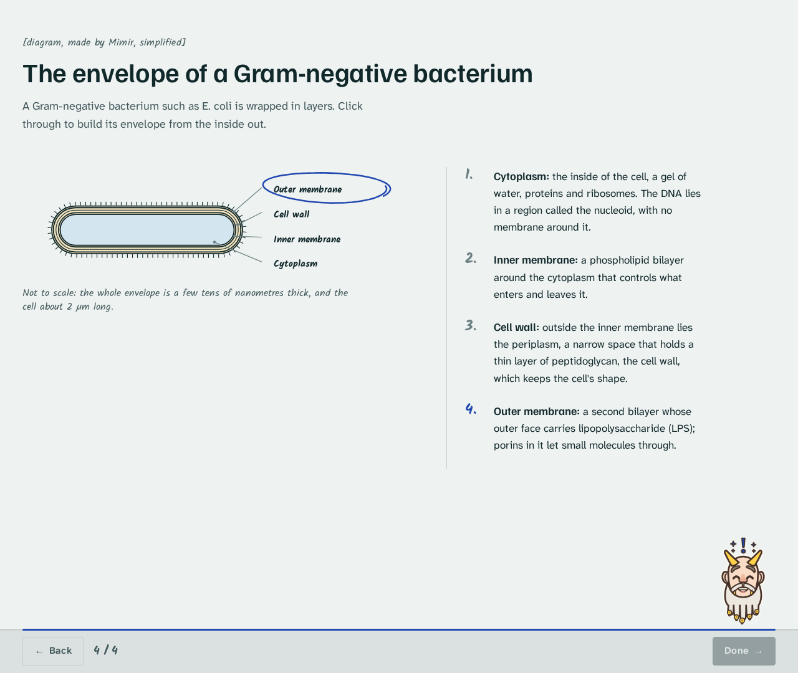
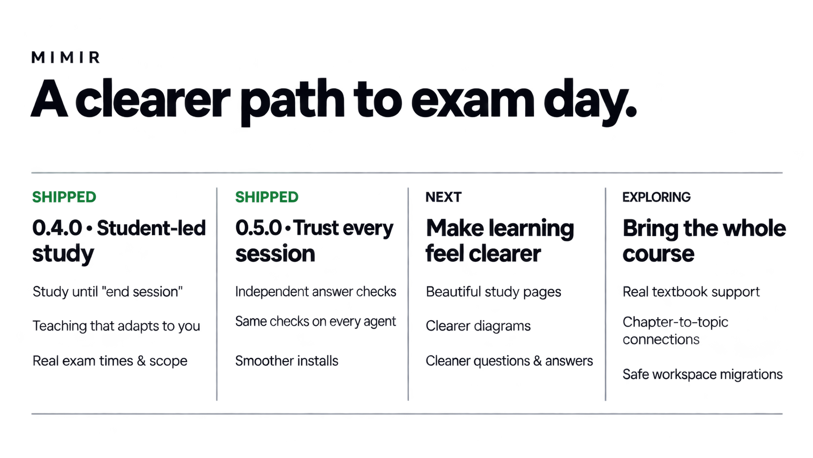

# Mimir: A head start, literally

**Version 0.5.0** · early release, features and file layout may still change ([roadmap](#roadmap), [changelog](CHANGELOG.md))

Mimir is an exam study plugin for AI coding agents: [Claude Code](https://claude.com/claude-code), [Codex](https://developers.openai.com/codex) and [Antigravity](https://antigravity.google). It teaches you course material in your professor's style and remembers what you know across sessions.

## What it does

- **Starts from wherever you are.** Type "exam tomorrow, help" and attach a photo of a past paper. Mimir starts drilling right away, with no setup.
- **Sets the pace from the exam date.** Far from the exam, Mimir teaches (Standard). Close to it, it drills question types ranked by marks and by how often they appeared in past papers (Urgent), shown as a table with nothing cut, and teaches each type with a short recipe before testing it. Tell it what an exam covers ("the midterm covers sessions 1–19") and, once you confirm the list, it drills only those types and lists the rest last. It picks the mode and tells you why. Sessions run until you say "end session".
- **Follows your professor.** Mimir reads the outline, slides and past papers, learns how the professor writes questions, and labels every question with where it came from. Answer keys are checked before you see them.
- **Teaches in your language.** Your course and exams can be in one language and the explanations in another. You choose both during setup.
- **Remembers you.** It keeps dated evidence of what you solved alone and with help, and picks up where you left off.
- **Keeps your files on your machine.** Everything lives in one folder (default `~/learning/`). Generated pages work offline, and Mimir sends no telemetry. The course files Mimir reads are sent to your agent's model provider, like any other file your agent reads. When ingest meets a course's field for the first time, a helper searches the web for that field's figure conventions; its searches carry only the field name and public topic names, never text from your files.

## What it looks like

Pages and diagrams follow Mimir's house style, Skald: a chalk board in dark theme, a whiteboard in light theme. You click through a page one step at a time, and the newest step is marked. The first three pages were built for a made-up automata course, the last for a made-up biology course, shown here with every step revealed. How they were made, and how to rebuild them, is in [`docs/showcase/`](docs/showcase/).

A worked answer, step by step:

<picture>
  <source media="(prefers-color-scheme: dark)" srcset="assets/showcase/cfg-language-dark.png">
  
</picture>

A state diagram you can feed an input into:

<picture>
  <source media="(prefers-color-scheme: dark)" srcset="assets/showcase/even-as-dfa-dark.png">
  
</picture>

A structure built up part by part:

<picture>
  <source media="(prefers-color-scheme: dark)" srcset="assets/showcase/pda-parts-dark.png">
  
</picture>

A real thing drawn layer by layer:

<picture>
  <source media="(prefers-color-scheme: dark)" srcset="assets/showcase/bacterium-envelope-dark.png">
  
</picture>

## Install

You need Python 3.11 or newer (available as `python3`) and one of the agents below. For Codex and Antigravity, also install `pdftotext` (part of poppler: preinstalled on most Linux, `brew install poppler` on macOS) for the best PDF text; without it Mimir falls back to a simpler built-in reader.

**Claude Code**

```
/plugin marketplace add oguzdogmus/mimir
/plugin install mimir@mimir
```

**Codex**

```sh
codex plugin marketplace add oguzdogmus/mimir
codex plugin add mimir@mimir
```

**Antigravity**

Install the plugin, then always launch from your learning folder with the plugin directory added, and grant the permission requests for both directories:

```sh
agy plugin install https://github.com/oguzdogmus/mimir
mkdir -p ~/learning && cd ~/learning
agy --add-dir "$(realpath ~/.gemini/config/plugins/mimir)"
```

**From a local clone** (any agent): `git clone https://github.com/oguzdogmus/mimir.git ~/mimir`, then use `~/mimir` in place of `oguzdogmus/mimir` or the GitHub URL above. To try it in Claude Code for one session without installing: `claude --plugin-dir ~/mimir`.

## Quick start

1. Run `mimir-setup` once to create your learning folder.
2. Drop course files (outline, slides, past papers) into `~/learning/_inbox/` and run `mimir-ingest`.
3. Run `mimir-study` and tell it when your exam is.

Each command is a skill, 10 in all (listed under [Commands](#commands)). The rules every skill follows are plain files in the plugin's `reference/` folder, not commands. Type a command like this:

| Agent | Format | Example |
|---|---|---|
| Claude Code | `/mimir:<skill>` | `/mimir:mimir-setup` |
| Codex | `$<skill>` | `$mimir-setup` |
| Antigravity | `/<skill>` | `/mimir-setup` |

`mimir-setup` and `mimir-ingest` change your files, so they only run when you type the command yourself; asking in plain words ("set me up") does not start them. For every other command you can just say what you want ("quiz me on automata") and the agent picks the skill. Not sure which fits? Run `mimir-help`.

## Commands

| Skill | What it is for |
|---|---|
| `mimir-setup` | One-time setup: your learning folder, languages and any exam dates you know. |
| `mimir-ingest` | File everything in your `_inbox/` into course folders. |
| `mimir-study` | Study for an exam. Start here: "exam Friday, help" works, even with just a photo of a past paper. |
| `mimir-past-questions` | Drill a course's real past-paper questions, most marks and most often asked first. |
| `mimir-quiz` | Get quizzed at exam level in your professor's style, with checked answer keys. |
| `mimir-plan` | See what is left to study before your exam. |
| `mimir-forecast` | A ranked guess at the topics of your next exam, with the evidence. |
| `mimir-progress` | What Mimir believes you know in a course, with dated evidence. |
| `mimir-debrief` | After an exam: what was on it, and what that changes. |
| `mimir-help` | Tells you which command fits your situation. |

## Your learning folder

`mimir-ingest` sorts what you drop in `_inbox/` into one folder per course and term:

```
~/learning/
├── _inbox/                  drop new course files here
├── .state/profile.md        languages and exam dates
└── 2026-Fall/
    └── CS201 Theory/
        ├── INDEX.md         file list and topic map
        ├── outline/  slides/  past-papers/  notes/
        └── .state/          mastery, professor style, exam scope, forecast, session logs, generated pages
```

- **Supported files:** PDF; images (jpg, png, heic, webp, gif, tiff, bmp); text (md, txt, tex); documents (docx, pptx, odt, odp). Anything else is skipped and left in `_inbox/`.
- **Large files cost usage.** Mimir reads your documents through your agent, so big slide decks and scanned papers use a good share of your plan's tokens.
- **Changing settings.** Pick a different folder during setup. Its path is then stored in `~/.config/mimir/root`. To change languages or exam dates later, edit `.state/profile.md` (plain Markdown), or tell `mimir-study` your new exam date.
- **Backups.** Everything Mimir knows about you is in this folder. Copy it to back it up.

The layout may change before 1.0. See [Roadmap](#roadmap).

## Update or uninstall

Restart your agent after updating. Installed copies do not follow edits to a local clone; update or reinstall to pick them up.

| Agent | Update | Uninstall |
|---|---|---|
| Claude Code | `claude plugin marketplace update mimir`, then `claude plugin update mimir@mimir` | `claude plugin uninstall mimir@mimir` |
| Codex | `codex plugin marketplace upgrade mimir`, then `codex plugin add mimir@mimir` | `codex plugin remove mimir@mimir` |
| Antigravity | `agy plugin uninstall mimir`, then install again | `agy plugin uninstall mimir` |

Uninstalling leaves your learning folder untouched.

## How answer keys are checked

Before you see an answer key, a second agent, the checker, checks it. Mimir's scripts keep a check ledger for every session in the course's `.state/checks/`: each prepared question with its key, its label, the checker's verdict and reason. A question earns mastery credit only when the ledger shows a `correct` check for it.

- **What the checker reads.** One evidence pack per question set, written by the scripts: the questions and keys, the text of every cited PDF page and small notes file, the paths of longer files and scans, and the professor's notation from the course fingerprint. It reads the pack and the files named in it, nothing else.
- **Real-paper labels.** A question shown as `[real: <file>, p.<N>]` has at least 8 words in a row of its wording on that page of the paper, checked by a script. A question from a scan says `[real, from photo/scan, wording may be off]` and shows the original beside it.
- **What the ledger proves, and what it does not.** The ledger stops forgetting, not lying. A checker reply must carry a token that only the evidence pack holds, so an agent that skips the checker cannot settle a check by accident. But the tutor and the checker share one shell, so no script can tell who called it, and an agent that invents a checker reply stays invisible to the scripts. Only the live acceptance runs show that a real checker ran.
- **Read-only checker, per agent.** On Claude Code the agent enforces it: the checker has only Read, Grep and Glob, and no shell. On Codex it is a rule in the checker's instructions, because Codex cannot limit the tools of a helper it starts. On Antigravity it is a rule in the instructions too: Antigravity ties reading files outside its workspace to command access, and a helper given command access also gets write tools. When an agent has no helper at all, the tutor checks its own keys from the same pack and tells you once per session.

## Compatibility

Tested with Claude Code, Codex and Antigravity. Cursor, Grok Build and Muse Code read the same skill format and may work, but are not tested yet.

So far live sessions have only been checked by hand on **CachyOS (Arch Linux)**. Mimir uses only the Python standard library and each system's default file opener, so other Linux distributions should work. On other systems:

- Claude Code on Windows with Git Bash: the scripts are tested in CI; no session has been checked by hand.
- Codex and Antigravity on Windows: through WSL only; no session has been checked by hand.
- macOS: the scripts are tested in CI; no session has been checked by hand.

If something breaks on your system or agent, please [open an issue](https://github.com/oguzdogmus/mimir/issues).

## Troubleshooting

**Antigravity can't read Mimir's files.** Launch with `--add-dir` as shown in [Install](#install) and accept the permission requests. A skill symlink alone does not grant access to the plugin folder.

**Antigravity through another app doesn't show Mimir's skills.** If the app doesn't load plugins, link the skills in:

```sh
ln -s ~/.gemini/config/plugins/mimir/skills/mimir-* ~/.gemini/config/skills/
```

If that app doesn't expand slash commands either, run `mimir-setup` and `mimir-ingest` in the Antigravity CLI. The other commands work in plain words.

## Roadmap

<picture>
  <source media="(prefers-color-scheme: dark)" srcset="assets/roadmap/mimir-roadmap-readme-dark.png">
  
</picture>

Priorities come from hands-on testing and may change. There are no promised dates. Until 1.0, expect changes to how sessions run and to the folder layout. What changed in each version is in the [changelog](CHANGELOG.md).

- **In 0.5.0: trust every session.** Answer keys are checked by an independent helper on Claude Code, Codex and Antigravity ([#23](https://github.com/oguzdogmus/mimir/issues/23), [#2](https://github.com/oguzdogmus/mimir/issues/2)), and installs are smoother ([#3](https://github.com/oguzdogmus/mimir/issues/3), [#4](https://github.com/oguzdogmus/mimir/issues/4)). Live runs covered Linux. macOS and Windows pass the script tests in CI, and macOS, Windows and WSL have not been checked by hand ([`RELEASE.md`](RELEASE.md)).
- **Next: make learning feel clearer.** Better-looking pages and diagrams, cleaner question and answer formatting in chat (especially the Claude mobile and desktop apps).
- **Exploring: bring the whole course.** Real textbook support (today ingest files a textbook, but sessions never read it), chapters linked to course topics, and safe migrations when the folder layout changes.

## Development

Run every check from a clone with `python3 tests/check.py`: the lint (pinned ruff), the tests in parallel and the release build (`release_check.py --no-open`), in that order, stopping at the first failure. Name steps to run only those, for example `python3 tests/check.py lint tests`. Once per clone, `git config core.hooksPath .githooks` turns on the repo's commit hook, which deletes git's leftover `# Conflicts:` block from a merge's commit message. Coding rules are in [`CODING_STANDARDS.md`](CODING_STANDARDS.md). The manual cross-platform check before a release is in [`RELEASE.md`](RELEASE.md). Issues and their labels are described in [`docs/agents/`](docs/agents/).

## License

Mimir is open source under the [Apache License 2.0](LICENSE). You can use, change and share it, including commercially, as long as you keep the [`LICENSE`](LICENSE) and [`NOTICE`](NOTICE) files and say which files you changed.

## Credits

Pages with math use [KaTeX](https://katex.org/) (MIT license), vendored in `assets/vendor/katex/`.

The Skald house style bundles the fonts Familjen Grotesk, Atkinson Hyperlegible Next and Kalam (SIL Open Font License 1.1) in `assets/skald/fonts/`, each with its licence.

`mimir-help` is modelled on Matt Pocock's [`ask-matt`](https://github.com/mattpocock/skills) router skill.
